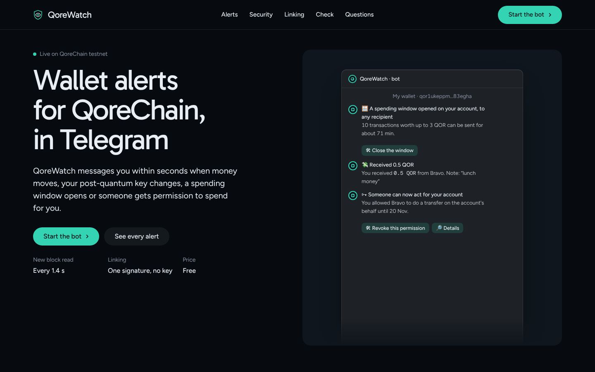
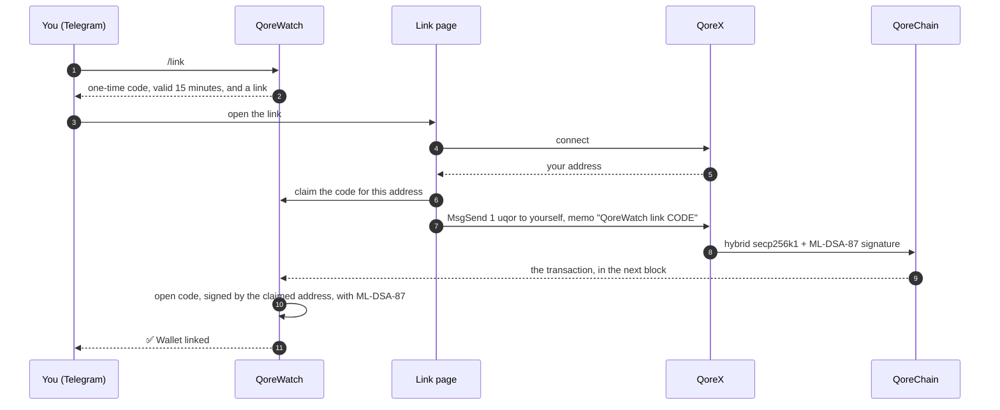
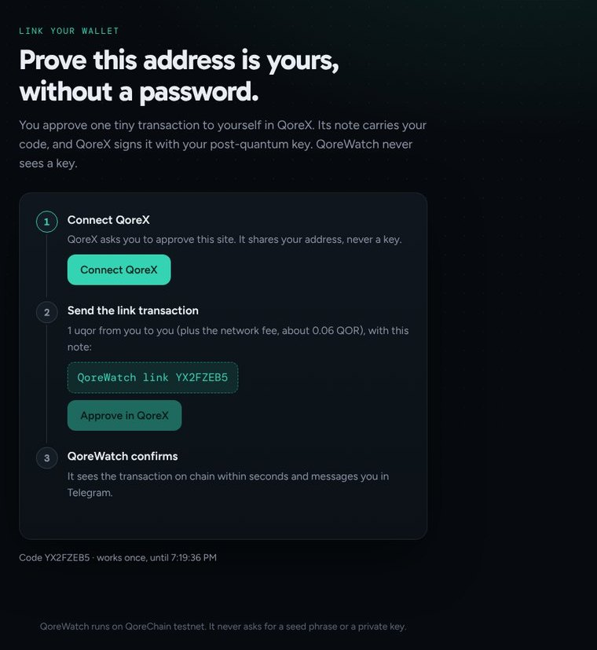
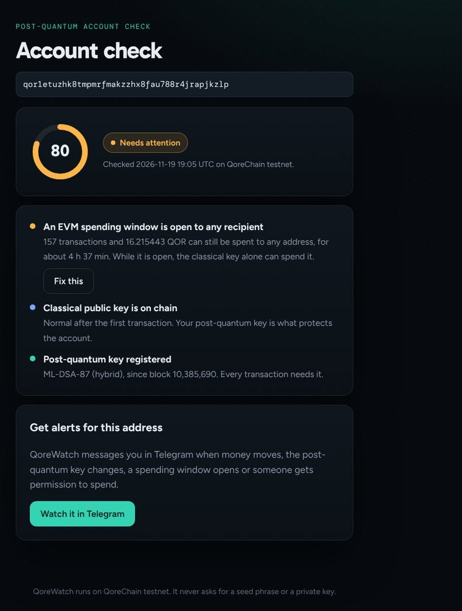
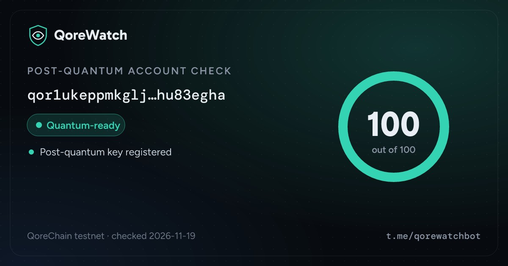
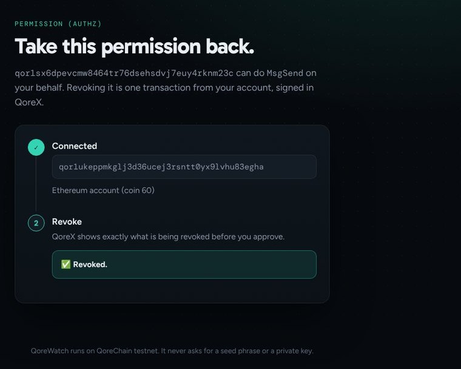
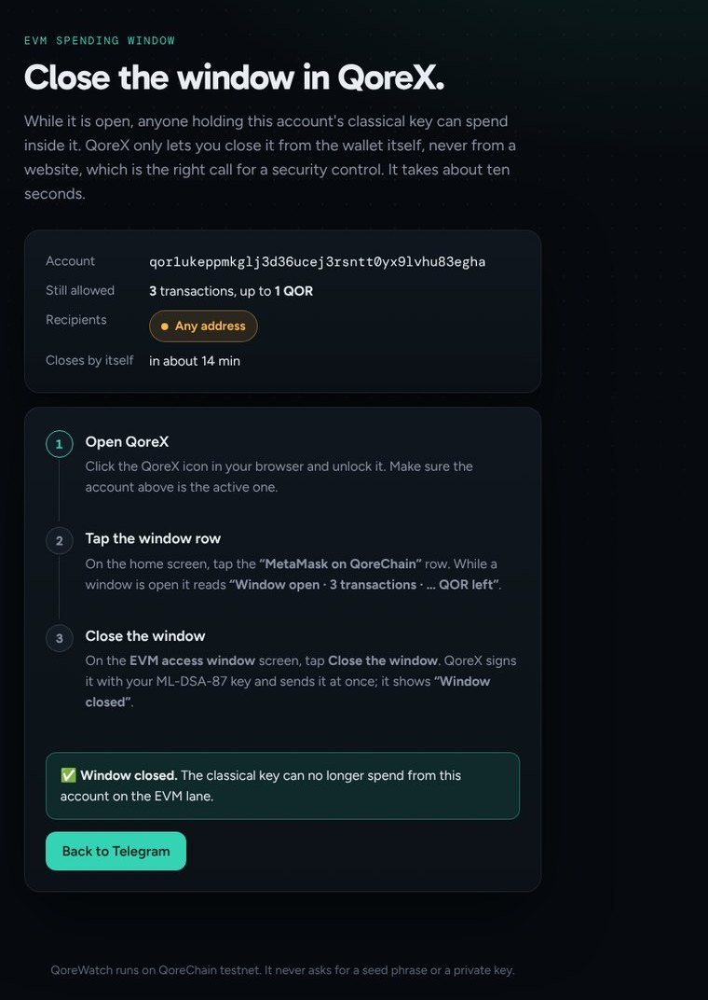
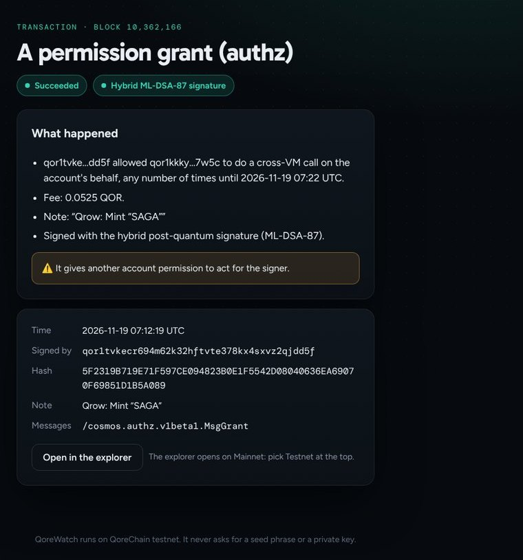
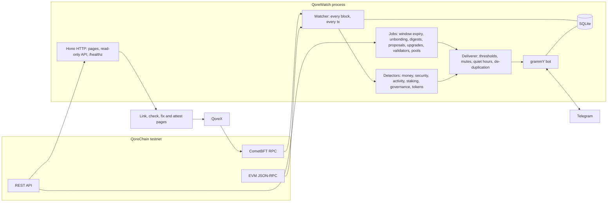

# QoreWatch

**Wallet alerts for QoreChain, in Telegram.** QoreWatch messages you within seconds when money moves on your address, your post-quantum key changes, a spending window opens or someone gets permission to spend for you. Each alert is in plain words, with a button for the details or the fix.

Built for the QoreChain *Build Before Q-Day* Developer Fest, Quantum Pass track. Live on QoreChain testnet (`qorechain-diana`).

**Start it: [t.me/qorewatchbot](https://t.me/qorewatchbot)** · **Website: [qorewatch.185-7-81-139.sslip.io](https://qorewatch.185-7-81-139.sslip.io/)**



| | |
| --- | --- |
| Bot | [@qorewatchbot](https://t.me/qorewatchbot), 22 commands, private chats and groups |
| Reads | every block of `qorechain-diana` (about one every 1.4 s): native transactions, their events and EVM token logs |
| Linking | one 1 uqor self-send signed in QoreX with ML-DSA-87 (hybrid); QoreWatch never sees a key |
| Contract | `QoreWatchAttest` at [`0x52f29cb4f18ec44acbb997b94c0776e4e35ed273`](https://explore.qore.network/tx/0x14a8b49efa151586fd80ee234ceb3e981673c97679a3b6e3b7c97dd2b6967400) (testnet, block 10389715) |
| Tests | 152 automated (54 core, 85 bot, 6 web, 7 Foundry), including 4 security regressions from a second, attacker-minded audit pass; 30 of 30 live testnet steps; 6 of 6 pages with the real QoreX extension; 25 of 25 server checks on fresh and shared Ubuntu 24.04 servers ([audit.md](audit.md)) |
| Stack | Node 22, TypeScript, grammY, Hono, SQLite (`node:sqlite`), viem, Vite, Foundry |

---

## Contents

1. [Why this exists](#why-this-exists)
2. [What QoreWatch alerts on](#what-qorewatch-alerts-on)
3. [How linking works](#how-linking-works)
4. [Account check and fixes](#account-check-and-fixes)
5. [Commands](#commands)
6. [Quantum Pass requirements](#quantum-pass-requirements)
7. [Architecture](#architecture)
8. [Security and privacy](#security-and-privacy)
9. [Run it locally](#run-it-locally)
10. [Deploy](#deploy)
11. [Add an alert](#add-an-alert)
12. [Testnet addresses](#testnet-addresses)
13. [Repository layout](#repository-layout)
14. [Limitations](#limitations)
15. [Credits and licence](#credits-and-licence)

---

## Why this exists

Every QoreChain account signs with two keys: a classical secp256k1 key and a post-quantum ML-DSA-87 key. The day a quantum computer can derive secp256k1 keys ("Q-Day"), the classical key stops being a secret. QoreChain is built so that the classical key alone is not enough. A few things still need watching, because they are exactly what an attacker holding your classical key would try first:

- **The post-quantum key itself.** A rotation or migration you did not make is the clearest sign of a takeover.
- **EVM spending windows.** While a window is open, the classical key alone can spend inside its limits, for its duration.
- **Permissions you gave away.** Authz grants, fee allowances, smart-account session keys, EVM delegations and unlimited token approvals all let another key act for you.
- **Classical-only signatures and anomaly flags.** QoreChain normally wants the post-quantum signature too.

Wallets show balances, not these events, and nobody watches a block explorer all day. QoreWatch reads every block and tells you, in the chat you already have open.

## What QoreWatch alerts on

Texts below are what the bot sent during the live testnet runs ([audit.md](audit.md)), shortened.

| Alert | Level | Example |
| --- | --- | --- |
| Money in and out (QOR and tokens, native and EVM) | info | 💸 **Received 0.5 QOR.** You received 0.5 QOR from Bravo. Note: "lunch money" |
| Post-quantum key rotated or migrated | **critical** | 🚨 **The post-quantum key of your account changed. Was this you?** |
| Post-quantum key registered, encryption (KEM) key registered | info | 🛡 **Post-quantum key registered** |
| EVM spending window opened, used, closing in 30 minutes, closed | warning | 🪟 **A spending window opened on your account, to any recipient.** 10 transactions worth up to 3 QOR can be sent for about 71 min. *[Close the window]* |
| Authz permission granted or revoked | warning | 🗝 **Someone can now act for your account.** You allowed Bravo to do a transfer on the account's behalf until 20 Nov. *[Revoke this permission]* |
| Fee allowance granted or revoked | warning | ⛽ **Someone can now spend your account's QOR on fees** *[Stop paying their fees]* |
| Smart-account session key added, removed, spending rules changed | warning | **A session key can now sign for your smart account** |
| EVM delegation consent and clear | warning | 🗝 **Another address can now act for your account** |
| Unlimited token approval, approval removed | warning | 🗝 **Unlimited token approval on your account.** You allowed 0x6535…ed8f to spend all of the account's fUSD. *[Revoke]* |
| Classical-only signature, anomaly check flag | warning | ⚠️ **A classical-only signature was used on Treasury** |
| Failed transaction from the account | warning | ❌ **A transaction from your account failed.** EVM: execution reverted. |
| Swaps, liquidity, contract calls | info | **Swap.** You swapped 28.971 QOR for 1.249856 fUSD in pool 2 |
| Staking: staked, unstaking started, unstaking finished, rewards, validator jailed | info / warning | ✅ **Unstaking finished.** 0.1 QOR is back in the account. |
| Governance: votes, new proposals, voting ends in 2 hours, results | info | 🗳 **Vote recorded.** You voted Yes on proposal #39 |
| Network: chain upgrade scheduled, in under an hour | info | 📡 **QoreChain testnet upgrades to v3.2.9** |
| Pool price alerts (opt in: `/pricealert 2 5`) | info | the price in AMM pool 2 moved by 5% or more |

**Critical alerts always arrive.** Pausing, muting a category, muting an address and quiet hours hold back everything else, but never a key change. Info alerts that arrive in quiet hours wait until they end. A daily digest (`/digest 09:00`) sums up the day.

Watch your own wallet (linked) or any address read-only, with labels: "Treasury", "Bravo". In a group, admins choose the addresses and everyone sees the alerts. QoreX `@handles` work wherever an address does; QoreWatch verifies the handle record before it uses it.

## How linking works

A read-only watch needs nothing. Linking proves the address is yours, which unlocks the alerts written for an owner ("your account", "was this you?") and `/attest`. It takes one tiny transaction, signed in QoreX with your post-quantum key.



The fee is about 0.06 test QOR. Only the owner can produce a transaction signed by that address, and QoreWatch accepts it only with the ML-DSA-87 signature. A code works once, for 15 minutes, and only for the address that claimed it on the page: someone who copies a pending code from the network into their own transaction links nothing ([audit.md](audit.md), F-1). The address linked is always the account whose key signed, never one that only paid the fee through a fee allowance, and a link paid through a fee grant is refused. In a group, the code goes to the admin who asked, in a private chat, never to the group ([audit.md](audit.md), F-8 and F-9).

| | |
| --- | --- |
|  | **The link page** connects QoreX, shows the exact transaction, and turns green when the chain confirms it. QoreX shows the memo and the 1 uqor amount before you approve. |

## Account check and fixes

`/check` takes any address or `@handle` and scores it out of 100. It reads the post-quantum key registration, an open EVM window and its limits, authz grants, fee allowances, session keys, the classical public key on chain and the balance, then lists a fix for each finding. `/check` can also send a share card.

| | |
| --- | --- |
|  | **The check page** (`/check/<address>`) with a live finding: an open window to any recipient, with *Fix this*. |
|  | **Share card**, rendered by the bot as a PNG (resvg, bundled OFL fonts). |

Fixes open from the alert's button:

- **Revoke a permission, a fee allowance or a token approval.** A QoreWatch page builds the exact message (`MsgRevoke`, `MsgRevokeAllowance` or `approve(spender, 0)`), QoreX shows it and signs it, and the page confirms on chain.
- **Close a window, remove a session key, register a key.** QoreX lets no website do these, which is the right call for security controls. The page shows the three taps in the wallet and watches the chain, then turns green by itself.

| | | |
| --- | --- | --- |
|  |  |  |
| Permission revoked in QoreX | Window closed in QoreX, confirmed from the chain | `/tx` explains any transaction in plain words |

**Attest.** `/attest` records your current score on QoreChain from your own account: the `QoreWatchAttest` contract stores the score, a SHA3-256 hash of the report and a one-time code. QoreWatch compares what lands on chain with the report it issued and confirms in Telegram. Anyone can rebuild the hash from a fresh check.

## Commands

| | |
| --- | --- |
| `/start` `/help` | menu and all commands |
| `/link` | link your wallet with QoreX |
| `/watch <address or @handle> [label]` | watch any address, read-only |
| `/list` | your watches, with per-address mute and threshold buttons |
| `/check <address>` | post-quantum health check, score out of 100 |
| `/tx <hash>` | explain a transaction |
| `/history <address>` | recent transactions |
| `/settings` | alert categories, quiet hours, time zone |
| `/quiet 23:00-07:00` `/timezone Africa/Lagos` | quiet hours in your own time |
| `/threshold 1` | minimum QOR amount for money alerts |
| `/digest 09:00` | a daily summary (or `off`, or `now`) |
| `/pools` `/pricealert <pool> <percent>` | AMM pools and prices; an alert when a pool's price moves by that much |
| `/proposals` | governance proposals |
| `/attest` | record your account check on QoreChain |
| `/pause` `/resume` | pause alerts (critical ones still arrive) |
| `/status` | is QoreWatch in sync with the chain |
| `/privacy` `/forget` | what is stored, and delete all of it |

## Quantum Pass requirements

Built for the Quantum Pass track ("a small original QoreChain app, tool, game or bot"; a Telegram bot is one of its examples). Each requirement, and where to check it:

| Requirement | How QoreWatch meets it | Where to check |
| --- | --- | --- |
| **Use create-qorechain-dapp** | The contracts workspace was scaffolded from its Foundry template, and its EVM window helper (`pnpm window`) registered the deployer's ML-DSA-87 key and opened the window for the deploy. | Commit `d71ca3b` ("Scaffold contracts from create-qorechain-dapp's foundry template"); [`contracts/README.md`](contracts/README.md); `contracts/scripts/window.ts`, `contracts/foundry.toml` |
| **Connect QoreX** | The link, revoke, attest and guided-fix pages connect QoreX and ask it to sign: a hybrid-signed self-send to link, `MsgRevoke`, `MsgRevokeAllowance`, `approve(spender, 0)` and the attest call. Tested with the real QoreX 0.4.3 extension: 6 of 6 pages. | [`apps/web/src/qorex.ts`](apps/web/src/qorex.ts), [`apps/web/src/pages/`](apps/web/src/pages/); [audit.md](audit.md), section 2 |
| **Deploy on testnet** | `QoreWatchAttest` is deployed on `qorechain-diana`, and the bot and its pages run live on a VPS. | `0x52f29cb4f18ec44acbb997b94c0776e4e35ed273`, block 10389715, deploy tx `0x14a8b49efa151586fd80ee234ceb3e981673c97679a3b6e3b7c97dd2b6967400`; [qorewatch.185-7-81-139.sslip.io](https://qorewatch.185-7-81-139.sslip.io/), [t.me/qorewatchbot](https://t.me/qorewatchbot) |
| **Complete a hybrid-signed transaction** | Linking requires one (QoreWatch rejects a classical-only link), and every native transaction of the live tests is hybrid secp256k1 + ML-DSA-87. | Deploy window `FE119A8198DF0203A457FAA87E42570C982A9283070F07A96759603C8B6CC710`; transfer `5D5A5ACD1E7C89936A88F941BD385C62910512F54374FE08ADBF6A0B4210C49A` (block 10437560); EVM window `DB6BB883674962B3C0531A3B5DB187B20EA0DE3A727B73EEF609640B79A8CB9A` (block 10437562) |

The submission checks are also covered: MIT [LICENSE](LICENSE), this README, the [testnet addresses](#testnet-addresses), the demo video (linked on the project page), and credits for every template, kit and library under [Credits and licence](#credits-and-licence).

## Architecture

One Node process runs the Telegram bot, the chain watcher, scheduled jobs and a small HTTP server for the web pages. State is one SQLite file.



- **`packages/core`** is the chain library, free of Telegram: RPC, REST and EVM readers with retries and a rate limit; a decoder for every QoreChain message type (PQC, abstract accounts, AMM, cross-VM, authz and feegrant `Any`s, CosmWasm); event parsing; plain-language explanations; the health check. Its tests run against recorded real testnet transactions.
- **`apps/bot`** holds the watcher, detectors, jobs, storage, Telegram views, cards, attest checks and the HTTP server.
- **`apps/web`** holds the landing page and the pages QoreX signs on (Vite, no framework). They read the chain through the bot's API, because QoreChain's REST API sends no CORS headers.
- **`contracts`** is `QoreWatchAttest`, with Foundry tests.

Failed native transactions drop their message events on QoreChain, so the watcher decodes transaction bodies as well as events. After an outage it catches up from where it stopped (up to `MAX_CATCHUP_BLOCKS`, about 70 minutes by default), so a restart loses no alert.

## Security and privacy

- **No keys, ever.** QoreWatch never asks for or holds a key or a recovery phrase. Linking and every fix are transactions you approve in QoreX.
- **What is stored:** chat ids, watched addresses with labels and settings, open link codes, scheduled reminders and which alerts were sent (pruned). `/privacy` shows it and `/forget` deletes it. Removing the bot from a group forgets that group.
- **Web pages:** a strict Content Security Policy (scripts from the site only, no inline scripts), `frame-ancestors 'none'`, `nosniff`, no referrer, and a per-address rate limit on the API. The pages hold no state and never read a key.
- **Server:** the bot runs as an unprivileged user under systemd hardening and can write only to its data folder. It listens on 127.0.0.1 behind Caddy (HTTPS). The Telegram token sits in a root-only file. See [deploy/README.md](deploy/README.md).
- **Groups:** only group admins can change what a group watches.

[audit.md](audit.md) has the review and the evidence.

## Run it locally

Requirements: Node 22.13 or newer, pnpm 10 (`corepack enable`), and [Foundry](https://getfoundry.sh) for the contract tests.

```bash
pnpm install
```

```bash
cp apps/bot/.env.example apps/bot/.env
```

Fill in `TELEGRAM_BOT_TOKEN` (from @BotFather) and `PUBLIC_URL` in `apps/bot/.env`. The file is ignored by git: never commit it or paste the token anywhere.

```bash
pnpm build
```

```bash
pnpm --filter @qorewatch/bot start
```

The pages are then at `http://127.0.0.1:8787`. For QoreX to sign on them from Telegram links, `PUBLIC_URL` must be an HTTPS address that reaches this server.

All checks (lint, types, every test, build):

```bash
pnpm check
```

The live scripts in `apps/bot/scripts` drive the real testnet with test keys you provide (`QW_KEYS`, a JSON file outside the repository) and a local stand-in for the Telegram API.

## Deploy

[deploy/README.md](deploy/README.md) covers a single VPS: Node 22, Caddy for HTTPS, systemd units, a daily database backup, rollback on a failed release, and a check script. It was tested on a fresh Ubuntu 24.04 server.

## Add an alert

Alerts are detectors: small functions that look at one transaction (or one EVM log) for one watched address and return alerts. To add one:

1. Write it in `apps/bot/src/alerts/detectors/` (see `staking.ts` for a short example).
2. Add it to the list in `apps/bot/src/alerts/detectors/index.ts`.
3. Add a test in `apps/bot/test/detectors.test.ts`, ideally against a real transaction recorded with `packages/core/scripts/record-fixtures.mjs`.

Delivery, thresholds, muting, quiet hours and de-duplication apply by themselves. Scheduled checks (time-based alerts) go in `apps/bot/src/watcher/jobs.ts`, and new commands in `apps/bot/src/telegram/bot.ts`.

## Testnet addresses

All on QoreChain testnet `qorechain-diana` (EVM chain 9800). Explorer: [explore.qore.network](https://explore.qore.network) (choose Testnet).

| What | Address |
| --- | --- |
| `QoreWatchAttest` contract | `0x52f29cb4f18ec44acbb997b94c0776e4e35ed273` / `qor12tefed833mzy4jaej7u5cpmkun34a5nnsr0a9v` (block 10389715) |
| Test wallet "alpha" (linked wallet in the tests; deployed the contract) | `qor1ukeppmkglj3d36ucej3rsntt0yx9lvhu83egha` / `0xe5B210Eec8FcA2D8eB98ccA2384D6B790C5fB2FC` |
| Test wallet "bravo" (second wallet: transfers, permissions) | `qor1sx6dpevcmw8464tr76dsehsdvj7euy4rknm23c` / `0x81B4D0e598dB8F5d5563F69B0cde0D64bD9E12a3` |
| Alpha's second account (key registered through the fix-key page) | `qor1kdlczz5mwkamhwnhsur8mfwhqy3t66vqhgzt6r` |
| A never-used account from the live run (key registration with proof of possession) | `qor1w822n4h5lr3y8ujmqlkt8gctnfgypzk77d95yk` |

## Repository layout

```
apps/
  bot/        Telegram bot, watcher, detectors, jobs, SQLite store, HTTP server
    src/alerts/detectors/   one file per alert family
    scripts/                live testnet scenarios (fake Telegram, real chain, real QoreX)
    test/                   unit and integration tests (fake Bot API, fake chain)
  web/        landing page and the link, check, tx, fix and attest pages
packages/
  core/       chain readers, decoder, explanations, health check (+ recorded fixtures)
contracts/    QoreWatchAttest (Foundry) and its deploy script
deploy/       systemd units, Caddy site, release and backup scripts
docs/         screenshots
```

## Limitations

- **Testnet only.** QoreWatch watches `qorechain-diana`. Mainnet is one setting (`QORE_NETWORK`), but it is untested there.
- **What never reaches a block cannot be reported.** QoreChain refuses some transactions at the door (for example a classical-only signature on a protected account). Nothing is recorded, so no bot can see them, and that refusal is the protection working.
- **Some fixes stay in QoreX.** Websites cannot close a window, remove a session key or register a key, so those fixes are guided steps in the wallet, confirmed from the chain.
- **The AI precompiles are not served** by the public node, so QoreWatch reports QoreChain's own `ai_anomaly_check` events but cannot call the risk-score precompile.
- **One process, one SQLite file.** Fine for thousands of watches. A much larger deployment would split the watcher and the bot.

## Credits and licence

- The contract workspace started from the Foundry template of [`create-qorechain-dapp`](https://www.npmjs.com/package/create-qorechain-dapp).
- Built with [@qorechain/sdk](https://www.npmjs.com/package/@qorechain/sdk), [grammY](https://grammy.dev), [Hono](https://hono.dev), [viem](https://viem.sh), [CosmJS](https://github.com/cosmos/cosmjs), [resvg-js](https://github.com/yisibl/resvg-js), [Vite](https://vite.dev) and [Foundry](https://getfoundry.sh).
- Fonts: Gabarito, Figtree and DM Mono, under the SIL Open Font License (`apps/bot/assets/fonts`, and through Fontsource for the web).
- The landing page uses the tasteskill design kit.
- How AI tools were used: [AI_USAGE.md](AI_USAGE.md).

MIT licence, see [LICENSE](LICENSE).
